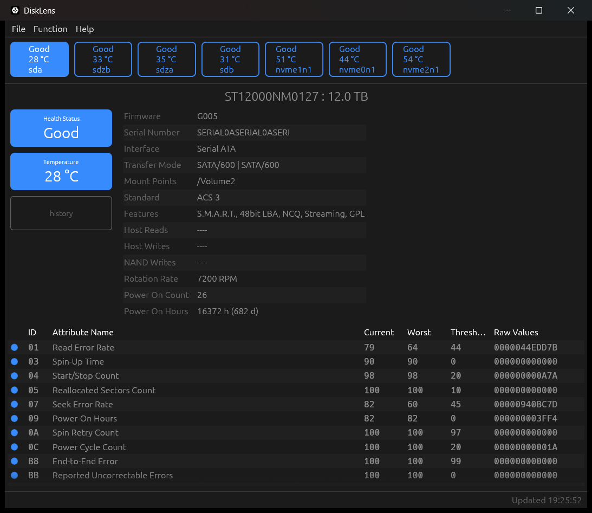
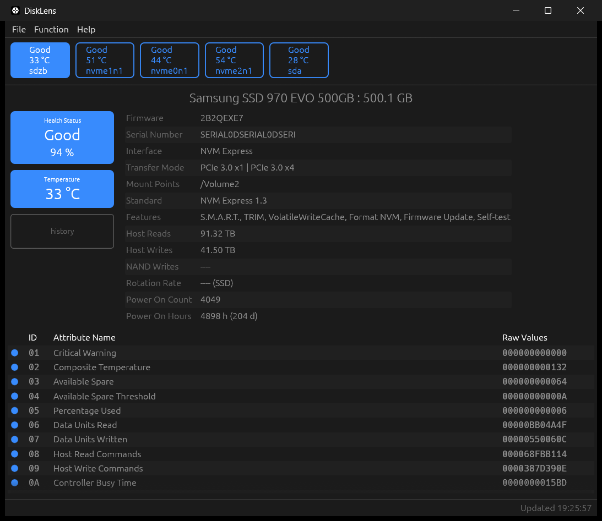
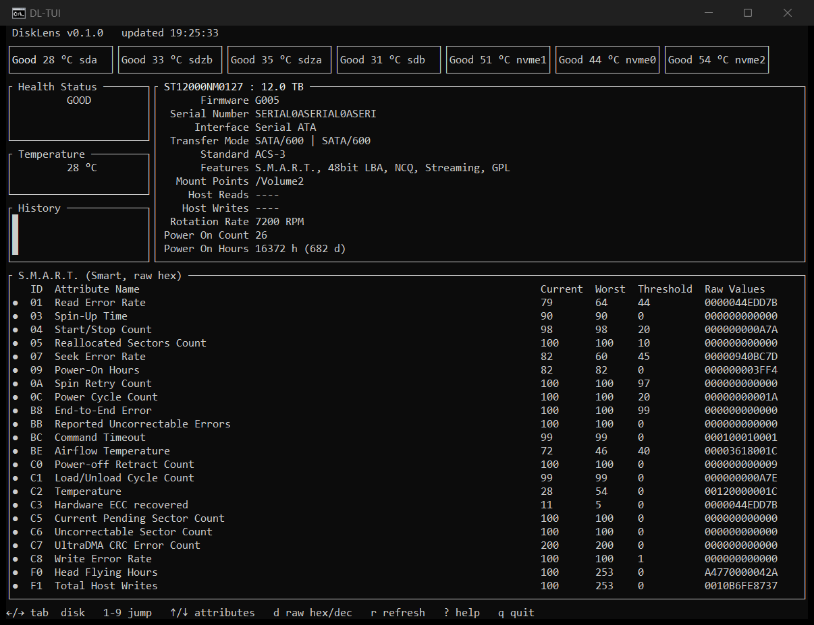
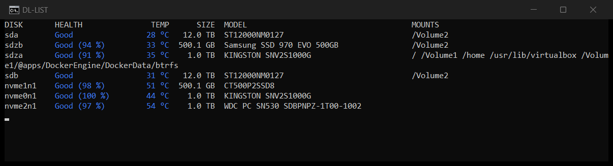
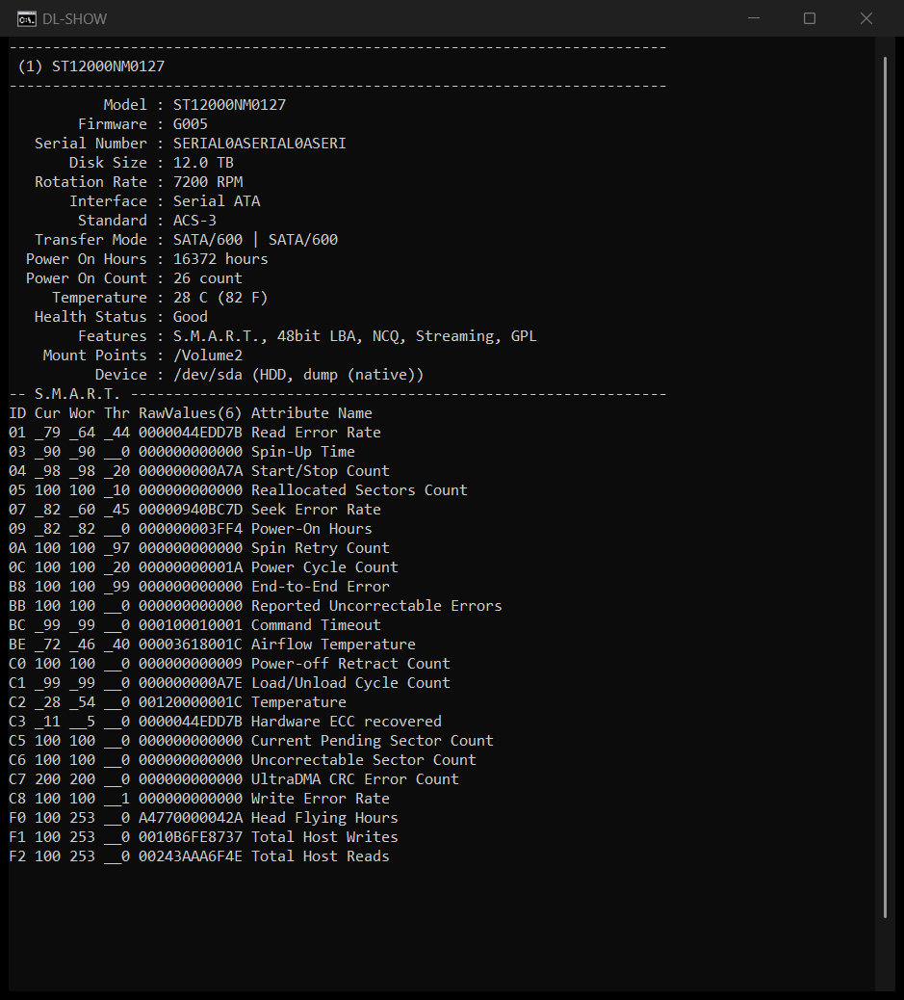
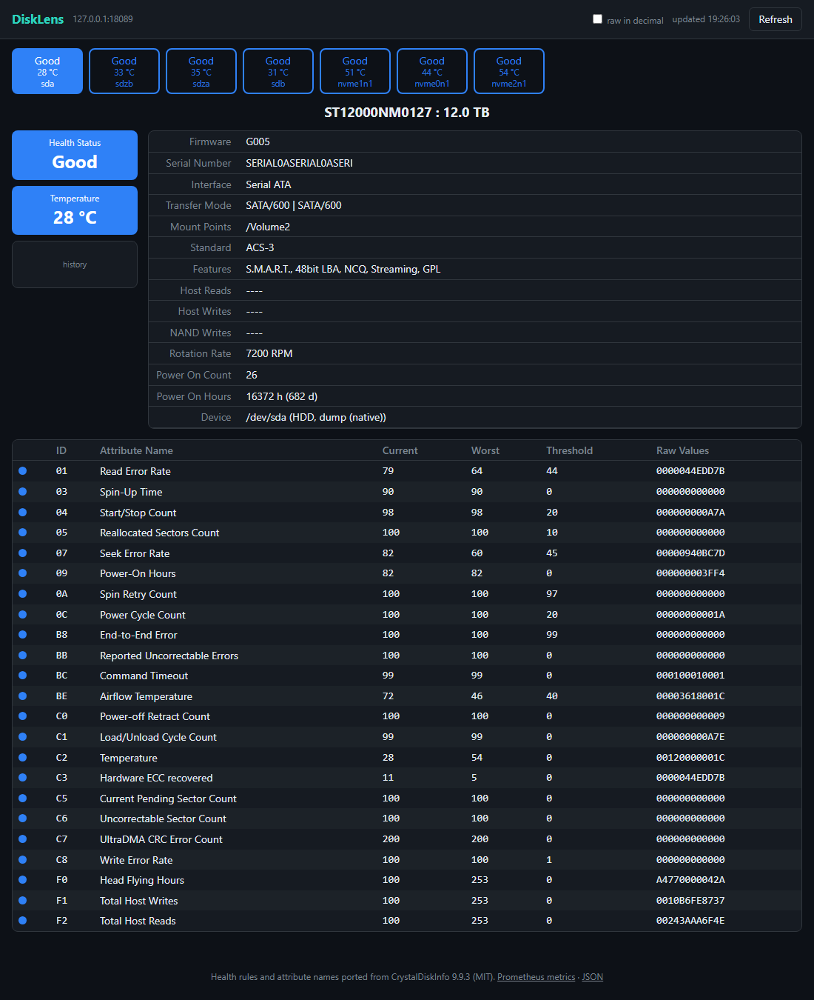
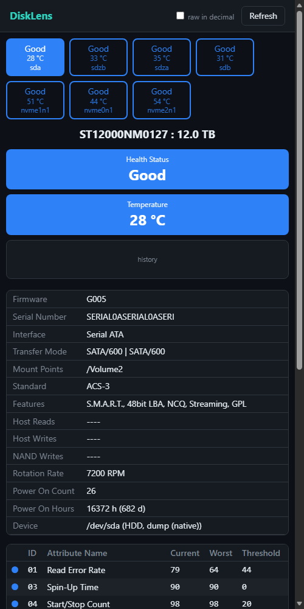

# DiskLens

Disk health (S.M.A.R.T.) for Linux and Windows, with the evaluation of
[CrystalDiskInfo](https://crystalmark.info/en/software/crystaldiskinfo/) ported line by line:
the same vendor detection (more than 40 SSD vendor and controller tables), the same
Good / Caution / Bad / Unknown verdict, life, temperature, host writes, and the same attribute
names. One engine, four front ends:

| Front end | Command | For |
|---|---|---|
| Terminal UI | `disklens` | SSH sessions, consoles |
| Plain CLI | `disklens list`, `show`, `check` | scripts, cron, monitoring |
| Desktop window | `disklens gui` | GNOME, KDE, any X11/Wayland desktop, Windows |
| Web interface + JSON API + Prometheus | `disklens web` | headless servers, NAS |

| Platform | Native backend | Fallback | Tested on |
|---|---|---|---|
| Linux (x86-64, any distribution) | SG_IO ATA pass-through, NVMe admin ioctls | smartctl | TerraMaster NAS (TOS, kernel 6.12): 2 SATA HDD + 2 NVMe; Ubuntu 24.04 (WSL) |
| Windows 10/11 | NVMe storage query (no administrator needed), ATA pass-through | smartctl | Windows 11: 3 NVMe |
| macOS, BSD | none | smartctl (`brew install smartmontools`) | compiled in CI only |

## Screenshots

All screenshots show real disks (two Seagate Exos HDDs, Samsung, Kingston, Crucial and WD
NVMe drives), loaded from the captures in `tests/captures/`.

**Desktop window** (`disklens gui`)





**Terminal UI** (`disklens`)



**CLI** (`disklens list`, `disklens show sda`)





**Web interface** (`disklens web`), desktop and phone





## Install

Prebuilt binaries are on the [releases page](https://github.com/PabloSoage/disklens/releases):

| File | |
|---|---|
| `disklens-*-x86_64-windows.exe` | Windows, all four front ends |
| `disklens_*_amd64.deb` | Debian / Ubuntu package (binary, desktop entry, systemd unit, polkit policy) |
| `disklens-*-x86_64-linux-gnu` | Linux, all four front ends (glibc 2.39+) |
| `disklens-*-x86_64-linux-musl-headless` | Linux, static, terminal + web only: runs on any distribution or NAS |

From source on Linux:

```sh
sh scripts/setup.sh                 # build tools (Debian/Ubuntu/Fedora), smartmontools optional
sh scripts/install.sh               # terminal, GUI and web
sh scripts/install.sh --headless    # servers: terminal and web only, no GUI libraries
sh scripts/install.sh --headless --service   # and run the web interface under systemd
```

The headless build also comes as a static binary (musl, no runtime dependencies) from CI;
copy it anywhere and run it.

`cargo deb` builds a `.deb` with the binary, the desktop entry, the systemd unit and the
polkit policy.

## Permissions

Reading SMART data sends raw commands to the disk, which on Linux needs root:

- Terminal and CLI: `sudo disklens`.
- GUI: run it as your user and press **Read as administrator**. It starts
  `pkexec disklens stream`, a privileged helper that sends the scans back; the password is
  asked once and the window itself never runs as root.
- Web: the `disklens-web` systemd service runs as root with only `CAP_SYS_RAWIO` and
  `CAP_SYS_ADMIN`, a read-only file system and no home access.

Without root every disk is still listed (model, size, mounts from sysfs) with health
*Unknown* and the reason.

On Windows, NVMe disks are read without administrator rights. SATA disks need it: start the
console as administrator, or press **Read as administrator** in the window, which restarts it through UAC.

## How the data is read

| Disk | Native backend |
|---|---|
| SATA, and USB-SATA bridges that implement SAT | `SG_IO` + ATA PASS-THROUGH (16), falling back to (12) |
| NVMe (also NAS systems that rename namespaces, like TerraMaster's `sdz*`) | `NVME_IOCTL_ADMIN_CMD`: Identify Controller / Namespace, log page 0x02 |
| Windows NVMe | `IOCTL_STORAGE_QUERY_PROPERTY` (protocol-specific Identify and log 0x02) |
| Windows SATA | `IOCTL_ATA_PASS_THROUGH` |
| RAID controllers, odd USB bridges | `smartctl -j` (smartmontools), converted back to raw pages |

`--backend auto` (default) tries the native path and falls back to `smartctl` when it is
installed. Both go through the same analysis, so the verdict does not depend on the backend.

## Web interface

```sh
sudo disklens web                                      # http://127.0.0.1:8086
sudo DISKLENS_TOKEN=change-me disklens web --bind 0.0.0.0:8086
```

| Path | |
|---|---|
| `/` | the page: disk buttons, health and temperature boxes, attribute table, temperature history |
| `/api/disks`, `/api/disks/{name}` | JSON reports |
| `/api/history` | recent temperature / life samples |
| `POST /api/refresh` | scan now |
| `/metrics` | Prometheus: `disklens_health`, `_temperature_celsius`, `_life_percent`, `_power_on_hours`, ... |

With a token, send `Authorization: Bearer <token>` or open `http://host:8086/#token=<token>`.

## Scripts and monitoring

```sh
disklens check -q; echo $?        # 0 good, 1 caution, 2 bad, 3 unknown
disklens show sda --json | jq .temperature_c
disklens show                     # the same blocks as CrystalDiskInfo's DiskInfo.txt
```

Thresholds as in CrystalDiskInfo's settings: `--life-caution 10`, `--sector-caution 1`,
`--alarm-hdd 50`, `--alarm-ssd 60`.

## Reporting a misdetected disk

```sh
sudo disklens dump --out dumps/
disklens --from dumps/ show       # the same analysis, on any machine, without the disk
```

A dump holds the raw IDENTIFY / SMART / NVMe pages. `tools/redact_dump.py` removes the
serial number before you share it. Real dumps in `tests/captures/` are regression tests:
their expected values come from smartctl or from an independent decoder
(`tools/expected.py`), never from DiskLens.

## Building

```sh
cargo build --release                                   # everything
cargo build --release --no-default-features --features web   # no GUI
cargo test --all-targets
```

## License

MIT. The evaluation logic and attribute names come from CrystalDiskInfo 9.9.3,
© hiyohiyo and CrystalMark Inc., MIT; see [THIRD_PARTY.md](THIRD_PARTY.md). DiskLens is not
affiliated with CrystalMark.
